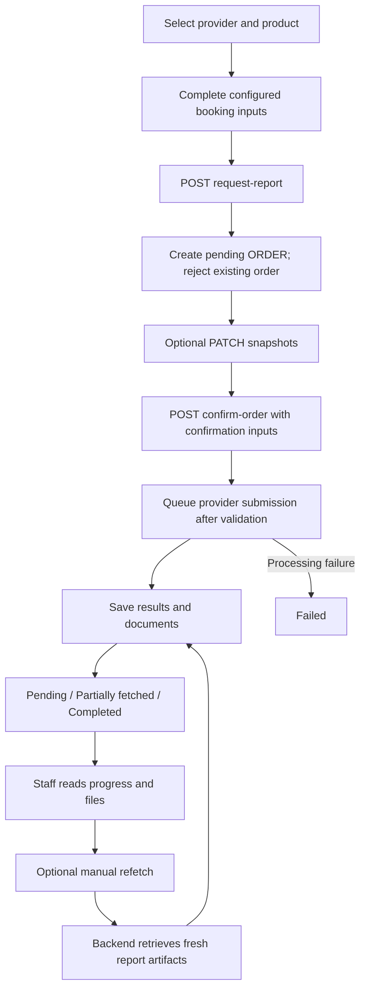

# Booking Order Request Flow — Frontend ePRD

Enable admins and associates to book provider-backed assessments, inspect submission progress, and access the resulting reports.

All frontend requests use `Authorization: Bearer <token>`. These endpoints do not require `X-Center-ID`.

The frontend uses one configuration-driven booking flow for every provider: refer to the returned fields, collect their values, and send the request. Provider and product names are display values. Field selection comes from the API configuration, and submission, validation, retries, and report retrieval are handled by the backend. Do not branch on provider names, codes, callbacks, or remote identifiers.

## Logical Flow

1. **List providers** — Load the assessment’s providers and their configurable booking inputs.
2. **List products** — Load products using the selected provider’s **code**.
3. **Create booking order** - Save configured booking and patient snapshots locally.
4. **Edit booking order** - Replace configured snapshots before confirmation.
5. **Confirm booking order** - Supply confirmation inputs and queue provider submission.
6. **List order requests** — Load existing orders when opening the screen or explicitly refreshing it.
7. **Read order request** — Inspect submission state, provider lifecycle, failures, and generated result IDs.
8. **List uploaded request files** - Open the complete paginated upload list when the three-file preview is insufficient.
9. **List result documents** — Open the files belonging to a generated result.
10. **Refetch reports** — Explicitly replace report output for a submitted order; unsubmitted orders must be confirmed first.
11. **Cancel order request** — Cancel local processing for an eligible request.



Order creation is local. Confirmation acceptance does not mean the provider booking or report retrieval has completed. Background workers update the persisted request.

Do not poll. Refresh request history through screen loading or an explicit refresh action.

## API Requests

### 1. List providers

Load active providers with an active product assignment to the assessment service.

**Method:** `GET`

**URL:** `<baseURL>/programs/program-services/assessment-services/:program_service_id/providers/`

| Path parameter | Required | Example | Notes |
| --- | --- | --- | --- |
| `program_service_id` | Yes | `<program-service UUID>` | Active assessment ProgramService |

| Query parameter | Required | Example | Notes |
| --- | --- | --- | --- |
| `page` | No | `1` | Default 1 |
| `limit` | No | `10` | Default 10; maximum 50 |

**Response — `200 OK`**

```json
{
  "detail": "All data.",
  "count": 1,
  "next": null,
  "previous": null,
  "data": [
    {
      "id": "<provider UUID>",
      "name": "Assessment Provider",
      "code": "PV-0007",
      "is_api_enabled": true,
      "fetch_fields": [],
      "fetch_profile_fields": [],
      "booking_fields": ["kit_id"],
      "booking_profile_fields": [],
      "confirm_order_fields": [],
      "confirm_order_file_fields": []
    }
  ]
}
```

Use the selected provider’s returned `booking_fields` as the source of truth for booking inputs and `booking_profile_fields` for the patient snapshot. Render and submit `kit_id` only when it appears in `booking_fields`; do not hardcode it as a universal field or derive its presence from the provider’s name or callback. Apply the same configuration-driven field selection to other booking inputs. Prefill available patient values and keep them editable.

Submit booking values under `data` and patient snapshots under `profile_data`. Render confirmation values from `confirm_order_fields` and send them inside `confirm_fields`. Submit each configured document using `confirm_files.<name>`. Strand requires consent when confirming and must remove `sample_collection_date` and `consent_file` from `booking_fields`, since confirmation owns them. This API returns stored arrays directly, and validation uses those arrays as the source of truth. Remove obsolete `sample_collected_at` and `consent_file` names from BugSpeaks configuration.

Both confirmation properties are arrays of field-name strings stored in Provider configuration, defaulting to `[]`. They do not contain objects with types or required flags. Every configured name is required when confirming an eligible order.

| Provider | `confirm_order_fields` | `confirm_order_file_fields` |
| --- | --- | --- |
| BugSpeaks | `[]` | `[]` |
| Strand | `["sample_collection_date"]` | `["consent_file"]` |
| MetSights, existing flow | `[]` | `[]` |

These are the required provider configurations for the existing integrations. Additional scalar and file names may be configured; refresh both arrays when switching providers. Each configured file name is a separate upload.

Booking profile choices are `full_name`, `age`, `gender`, `date_of_birth`, `email`, and `phone`. Do not submit unconfigured keys.

A listed provider is not guaranteed to accept a booking. The backend determines availability and returns validation errors; the frontend does not maintain a supported-provider or product-callback registry. The `fetch_fields` and `fetch_profile_fields` arrays belong to the separate existing-report fetch flow and do not determine booking inputs.

**Error — `404 Not Found`**

```json
{
  "detail": "Assessment program service not found."
}
```

### 2. List products

Load the selected provider’s active products assigned to this assessment.

**Method:** `GET`

**URL:** `<baseURL>/programs/program-services/assessment-services/:program_service_id/products/`

| Path parameter | Required | Example | Notes |
| --- | --- | --- | --- |
| `program_service_id` | Yes | `<program-service UUID>` | Active assessment ProgramService |

| Query parameter | Required | Example | Notes |
| --- | --- | --- | --- |
| `provider` | No | `PV-0007` | Exact provider **code**, not UUID |
| `page` | No | `1` | Default 1 |
| `limit` | No | `10` | Default 10; maximum 50 |

**Response — `200 OK`**

```json
{
  "detail": "All data.",
  "count": 1,
  "next": null,
  "previous": null,
  "data": [
    {
      "id": "<product UUID>",
      "name": "Assessment Product",
      "code": "PD-0018"
    }
  ]
}
```

Submit the selected item’s `id` as `product_id`. Changing providers clears the selected product and booking inputs. An unknown provider code returns an empty collection.

The same assessment-not-found error from step 1 applies.

### 3. Create booking order

Create a local ORDER with `status_code: "pending"` and `is_submitted: false`. This action schedules no task and calls no provider API.

**Method:** `POST`

**URL:** `<baseURL>/programs/program-services/assessment-services/:program_service_id/request-report/`

| Path parameter | Required | Example | Notes |
| --- | --- | --- | --- |
| `program_service_id` | Yes | `<program-service UUID>` | Active assessment ProgramService |

#### Payload

| Name | Required | Example | Notes |
| --- | --- | --- | --- |
| `product_id` | Yes | `<product UUID>` | Active product assigned to this service |
| `data` | Conditional | `{"kit_id":"KIT-1001"}` | Defaults to `{}`; include all configured `booking_fields` |
| `profile_data` | Conditional | `{"full_name":"Ananya Rao"}` | Defaults to `{}`; include all configured `booking_profile_fields` |

```json
{
  "product_id": "<product UUID>",
  "data": {"kit_id": "KIT-1001"},
  "profile_data": {}
}
```

This example assumes empty `booking_profile_fields`. Include configured patient fields when present. When both field arrays are empty, only `product_id` is needed. Consent and collection values are submitted at confirmation. Credentials stay in provider API configuration.

#### Response — `201 Created`

```json
{
  "detail": "Report request accepted.",
  "data": {
    "id": "<request UUID>",
    "product": {"id": "<product UUID>", "name": "Assessment Product", "code": "PD-0018"},
    "status": "Pending",
    "status_code": "pending",
    "request_type": "Order",
    "request_type_code": "order",
    "is_submitted": false,
    "attempts_count": 0,
    "failure_detail": "",
    "started_at": null,
    "completed_at": null,
    "created_at": "2026-10-07T10:00:00+05:30",
    "updated_at": "2026-10-07T10:00:00+05:30"
  }
}
```

The request input dictionaries are write-only on creation. Detail/history GETs expose saved `data.booking` and `profile_data`. Every configured key is required; extra dictionary keys are ignored. Creation checks the active service/product/provider assignment and supported handler. Working API credentials are required at confirmation.

One ORDER per program service is retained. Duplicate creation returns HTTP 400 regardless of status or submitted values:

```json
{"detail": "This service already has an order request."}
```

### 4. Edit booking order

Replace supplied configured snapshots while the ORDER is pending and unsubmitted.

**Method:** `PATCH`

**URL:** `<baseURL>/programs/program-services/result-requests/:request_id/`

| Path parameter | Required | Example | Notes |
| --- | --- | --- | --- |
| `request_id` | Yes | `<request UUID>` | ORDER with `status_code: "pending"` and `is_submitted: false` |

#### Payload

| Name | Required | Example | Notes |
| --- | --- | --- | --- |
| `data` | No | `{"kit_id":"KIT-1002"}` | Replaces booking snapshot; all configured keys required when supplied |
| `profile_data` | No | `{"full_name":"Ananya Rao"}` | Replaces patient snapshot; all configured keys required when supplied |

```json
{"data": {"kit_id": "KIT-1002"}}
```

Omitted snapshots are retained. Product and status are not editable. PATCH schedules no task. A concurrent edit or confirmation rejects a stale update; reload before retrying. GET and PATCH use one detail serializer, so the PATCH response contains the full saved request shape. The shared retrieve/update view also accepts PUT with the same editable fields and pending, unsubmitted order restriction.

#### Response — `200 OK`

```json
{
  "detail": "Updated successfully.",
  "data": {
    "id": "<request UUID>",
    "provider": {
      "id": "<provider UUID>",
      "name": "Assessment Provider",
      "code": "PV-0007"
    },
    "product": {
      "id": "<product UUID>",
      "name": "Assessment Product",
      "code": "PD-0018"
    },
    "data": {"booking": {"kit_id": "KIT-1002"}},
    "profile_data": {},
    "files": [],
    "provider_lifecycle": null,
    "status": "Pending",
    "status_code": "pending",
    "request_type": "Order",
    "request_type_code": "order",
    "is_submitted": false,
    "attempts_count": 0,
    "failure_detail": "",
    "started_at": null,
    "completed_at": null,
    "results": [],
    "created_by": {
      "id": "<user UUID>",
      "email": "staff@example.com",
      "first_name": "Rohan",
      "last_name": "Shah",
      "image": null,
      "last_login": null
    },
    "created_at": "2026-10-08T10:00:00+05:30",
    "updated_at": "2026-10-08T10:05:00+05:30"
  }
}
```

**Error — `400 Bad Request`**

```json
{"detail": "Only unsubmitted pending orders can be edited."}
```

### 5. Confirm booking order

Validate saved inputs and queue submission using the selected provider's callback.

**Method:** `POST`

**URL:** `<baseURL>/programs/program-services/result-requests/:request_id/confirm-order/`

| Path parameter | Required | Example | Notes |
| --- | --- | --- | --- |
| `request_id` | Yes | `<request UUID>` | Pending or failed, unsubmitted ORDER |

#### Payload

The serializer accepts optional `confirm_fields` JSON and optional `confirm_files`, a dictionary of named uploads. Each name in `confirm_order_fields` is a required JSON key. Each name in `confirm_order_file_fields` is a required upload key. Provider callbacks validate their values; unconfigured keys are ignored.

| Name | Required | Example | Notes |
| --- | --- | --- | --- |
| `confirm_fields` | When scalar fields are configured | `{"sample_collection_date":"2026-10-07"}` | JSON object; JSON-encoded form value in multipart requests |
| `confirm_files.<configured_name>` | For every configured file name | `confirm_files.consent_file` | One uploaded file per configured name |

With empty confirmation arrays, BugSpeaks and MetSights accept JSON:

```json
{}
```

Strand sends multipart form data:

```text
confirm_fields: {"sample_collection_date":"2026-10-07"}
confirm_files.consent_file: <uploaded consent document>
```

A provider configured with `confirm_order_file_fields: ["consent_file", "prescription_file"]` sends both named files:

```text
confirm_fields: {"sample_collection_date":"2026-10-07"}
confirm_files.consent_file: <uploaded consent document>
confirm_files.prescription_file: <uploaded prescription document>
```

The JSON example assumes `sample_collection_date` is configured. Build the JSON object from the selected provider's `confirm_order_fields`. Let the browser set the multipart boundary. Strand validates the collection date as `YYYY-MM-DD`. Booking and patient values come from the saved order; credentials come from `ProviderAPI.data`. BugSpeaks requires neither a collection timestamp nor consent; remove obsolete names from its stored configuration.

Confirmation values are saved under `data.confirmation`. Each upload is saved in a linked request-file record whose `field_name` matches the configured name. Retrying a failed, unsubmitted order replaces each uploaded file under the same name. Provider booking handlers explicitly map the named documents to their API arguments; Strand uses `consent_file`.

#### Response — `202 Accepted`

```json
{
  "detail": "Order confirmation accepted."
}
```

This is an acknowledgement only. No request object, files, or processing progress is returned. Background workers update submission progress; read the persisted state through request 7 and the uploaded-file records through request 8.
Configured confirmation values, named uploads, saved inputs, credentials, and active configuration are validated before queueing. BugSpeaks uses empty confirmation arrays by default; Strand reads `sample_collection_date` from `confirm_fields` and `consent_file` from `confirm_files`. Invalid requests schedule nothing. A conditional claim freezes the pending order's inputs and starts submission after commit. Background progress is read through the detail endpoint.

Reconfirming queued/running or successfully submitted orders returns the same HTTP 202 acknowledgement without another upload or submission. Concurrent confirmations cannot both claim submission. Failed unsubmitted orders may retry with required confirmation fields and uploads, reusing saved order snapshots. Cancelled orders cannot confirm. Manual report refetch and webhooks remain independent and never create another booking.

#### React Hook Form example

Render inputs from the selected provider's configuration. `onConfirm(body)` calls the existing authenticated API helper with this endpoint and the `FormData` body. Keep the helper's authentication and center headers; allow the browser to set `Content-Type` and its multipart boundary.

```jsx
import { useForm } from "react-hook-form";

export function ConfirmationForm({ provider, onConfirm }) {
  const { register, handleSubmit, formState: { isSubmitting } } = useForm({
    shouldUnregister: true,
  });

  const submit = async (values) => {
    const body = new FormData();
    body.append("confirm_fields", JSON.stringify(values.confirm_fields ?? {}));
    for (const name of provider.confirm_order_file_fields ?? []) {
      const file = values.confirm_files?.[name]?.[0];
      if (file) body.append(`confirm_files.${name}`, file);
    }
    await onConfirm(body);
  };

  return (
    <form onSubmit={handleSubmit(submit)}>
      {(provider.confirm_order_fields ?? []).map((name) => (
        <label key={name}>
          {name}
          <input {...register(`confirm_fields.${name}`, { required: true })} />
        </label>
      ))}
      {(provider.confirm_order_file_fields ?? []).map((name) => (
        <label key={name}>
          {name}
          <input type="file"
            {...register(`confirm_files.${name}`, { required: true })} />
        </label>
      ))}
      <button type="submit" disabled={isSubmitting}>Confirm order</button>
    </form>
  );
}
```

React Hook Form returns a `FileList` for a file input; `[0]` selects the one file assigned to that configured name. [Official file-input handling](https://github.com/react-hook-form/react-hook-form/blob/master/src/logic/getFieldValue.ts). Use a fresh form when switching providers so previous confirmation values are cleared. The API helper remains responsible for displaying server validation errors.

**Error — `400 Bad Request`**

```json
{"detail": "Only non-cancelled order requests can be confirmed."}
```
### 6. List order requests

Load the assessment’s order history.

**Method:** `GET`

**URL:** `<baseURL>/programs/program-services/assessment-services/:program_service_id/result-requests/`

| Path parameter | Required | Example | Notes |
| --- | --- | --- | --- |
| `program_service_id` | Yes | `<program-service UUID>` | Assessment ProgramService; may be inactive |

| Query parameter | Required | Example | Notes |
| --- | --- | --- | --- |
| `mode` | No | `order` | Send `order` for this screen; omission includes fetch requests |
| `status` | No | `pending` | Exact status code |
| `page` | No | `1` | Default 1 |
| `limit` | No | `10` | Default 10; maximum 50 |

Unknown `mode` and `status` values are ignored. Results are ordered newest first.

**Response — `200 OK`**

```json
{
  "detail": "All data.",
  "count": 1,
  "next": null,
  "previous": null,
  "data": [
    {
      "id": "<request UUID>",
      "provider": {
        "id": "<provider UUID>",
        "name": "Assessment Provider",
        "code": "PV-0007"
      },
      "product": {
        "id": "<product UUID>",
        "name": "Assessment Product",
        "code": "PD-0018"
      },
      "data": {
        "booking": {
          "kit_id": "KIT-1001"
        },
        "consent_hash": null
      },
      "profile_data": {},
      "provider_lifecycle": {
        "event": "Kit Dispatched",
        "received_at": "2026-10-06T10:05:00+05:30"
      },
      "status": "Pending",
      "status_code": "pending",
      "request_type": "Order",
      "request_type_code": "order",
      "is_submitted": true,
      "attempts_count": 1,
      "failure_detail": "",
      "started_at": "2026-10-06T10:00:01+05:30",
      "completed_at": "2026-10-06T10:00:02+05:30",
      "results": [],
      "created_by": {
        "id": "<user UUID>",
        "email": "staff@example.com",
        "first_name": "Rohan",
        "last_name": "Shah",
        "image": null,
        "last_login": null
      },
      "created_at": "2026-10-06T10:00:00+05:30",
      "updated_at": "2026-10-06T10:00:02+05:30",
      "files": [
        {
          "id": "<request-file UUID>",
          "field_name": "consent_file",
          "file": "<stored consent URL>",
          "filename": "consent.pdf",
          "content_type": "application/pdf",
          "is_active": true,
          "created_at": "2026-10-07T10:30:00+05:30",
          "updated_at": "2026-10-07T10:30:00+05:30"
        }
      ]
    }
  ]
}
```

`provider_lifecycle` is nullable. When present, display the returned event and timestamp without a provider-specific event mapping. Lifecycle events do not necessarily update the request’s processing status.

### 7. Read order request

Inspect one request and obtain its generated result IDs.

**Method:** `GET`

**URL:** `<baseURL>/programs/program-services/result-requests/:result_request_id/`

| Path parameter | Required | Example | Notes |
| --- | --- | --- | --- |
| `result_request_id` | Yes | `<request UUID>` | ID returned by submission/history |

**Response — `200 OK`**

```json
{
  "detail": "Details.",
  "data": {
    "id": "<request UUID>",
    "provider": {
      "id": "<provider UUID>",
      "name": "Assessment Provider",
      "code": "PV-0007"
    },
    "product": {
      "id": "<product UUID>",
      "name": "Assessment Product",
      "code": "PD-0018"
    },
    "data": {
      "booking": {
        "kit_id": "KIT-1001"
      },
      "consent_hash": null,
      "artifacts": {
        "pdf": "<PDF-document UUID>",
        "raw": "<spreadsheet-document UUID>"
      },
      "fetch_errors": []
    },
    "profile_data": {},
    "provider_lifecycle": {
      "event": "Completed",
      "received_at": "2026-10-06T12:00:00+05:30"
    },
    "status": "Completed",
    "status_code": "completed",
    "request_type": "Order",
    "request_type_code": "order",
    "is_submitted": true,
    "attempts_count": 2,
    "failure_detail": "",
    "started_at": "2026-10-06T12:00:01+05:30",
    "completed_at": "2026-10-06T12:00:03+05:30",
    "results": [
      {
        "id": "<result UUID>",
        "provider_name": "Assessment Provider",
        "product_name": "Assessment Product",
        "result_mode": "Order",
        "result_mode_code": "order",
        "document_type": "<returned document type label>",
        "document_type_code": "<returned document type code>",
        "sample_collection_date": null,
        "report_generation_date": null
      }
    ],
    "created_by": {
      "id": "<user UUID>",
      "email": "staff@example.com",
      "first_name": "Rohan",
      "last_name": "Shah",
      "image": null,
      "last_login": null
    },
    "created_at": "2026-10-06T10:00:00+05:30",
    "updated_at": "2026-10-06T12:00:03+05:30",
    "files": [
      {
        "id": "<request-file UUID>",
        "field_name": "consent_file",
        "file": "<stored consent URL>",
        "filename": "consent.pdf",
        "content_type": "application/pdf",
        "is_active": true,
        "created_at": "2026-10-07T10:30:00+05:30",
        "updated_at": "2026-10-07T10:30:00+05:30"
      }
    ]
  }
}
```

Read `data.booking` and `profile_data` when editing an unsubmitted pending ORDER; `files` contains at most three recent uploaded-file records, each with its own `file` URL. Request 8 lists all uploaded files. Treat the other keys in response `data` as opaque backend bookkeeping. Its keys vary, and examples are illustrative rather than an exhaustive schema. Do not interpret remote identifiers or artifact keys to determine frontend state; use `status_code`, `is_submitted`, `failure_detail`, and `results`.

| `status_code` | Meaning |
| --- | --- |
| `queued` | Waiting for a worker |
| `running` | Submission or retrieval is processing |
| `submitted` | Submission stage reported by the backend |
| `pending` | Awaiting confirmation when `is_submitted=false`; awaiting reports when `is_submitted=true` |
| `partially_fetched` | Some output saved; expected artifacts remain unavailable |
| `completed` | Expected output retrieved |
| `failed` | Processing failure; inspect `failure_detail` |
| `cancelled` | Local request cancelled |

For ORDER requests, `status_code: "pending"` and `is_submitted: false` permit editing and initial confirmation. After queueing, editing is disabled. A pending ORDER with `is_submitted: true` is waiting for reports; confirmation acknowledges it without submitting again. Failed unsubmitted orders can retry confirmation. FETCH requests keep their existing status behavior.

Use `*_code` fields for comparisons and display fields for labels. `is_submitted` indicates remote submission progress; it does not indicate report completion. `completed_at` can be populated while status is `pending`, because it records the worker attempt finishing.

**Error — `404 Not Found`**

```json
{
  "detail": "Result request not found."
}
```

### 8. List uploaded request files

List the uploaded confirmation documents belonging to a request, independently of generated report documents.

**Method:** `GET`

**URL:** `<baseURL>/programs/program-services/result-requests/:request_id/files/`

| Path parameter | Required | Example | Notes |
| --- | --- | --- | --- |
| `request_id` | Yes | `<request UUID>` | Assessment ResultRequest |

| Query parameter | Required | Example | Notes |
| --- | --- | --- | --- |
| `page` | No | `1` | Default 1 |
| `limit` | No | `10` | Existing pagination; maximum 50 |

#### Response — `200 OK`

```json
{
  "detail": "All data.",
  "count": 1,
  "next": null,
  "previous": null,
  "data": [
    {
      "id": "<request-file UUID>",
      "field_name": "supporting_document",
      "file": "<stored supporting-document URL>",
      "filename": "supporting-document.pdf",
      "content_type": "application/pdf",
      "is_active": true,
      "created_at": "2026-10-07T10:30:00+05:30",
      "updated_at": "2026-10-07T10:30:00+05:30"
    }
  ]
}
```

Files are ordered newest first. Request list/detail responses retain the same file-item serializer and preview limit. The full list is read-only; its URLs refer to request uploads, not provider-generated result documents. A failed unsubmitted order's confirmation retry replaces the saved record for each re-uploaded configured name. Report refetch and cancellation preserve request-file records.

**Error — `404 Not Found`**

```json
{"detail": "Result request not found."}
```
### 9. List result documents

Retrieve the files for a result returned by request history or detail (requests 6 and 7).

**Method:** `GET`

**URL:** `<baseURL>/programs/program-services/results/:result_id/documents/`

| Path parameter | Required | Example | Notes |
| --- | --- | --- | --- |
| `result_id` | Yes | `<result UUID>` | From the request’s `results` array |

| Query parameter | Required | Example | Notes |
| --- | --- | --- | --- |
| `document_type` | No | `<result.document_type_code>` | Exact parent result document type |
| `document_category` | No | `report` | `report` or `raw` |
| `search` | No | `pdf` | Case-insensitive filename substring |
| `page` | No | `1` | Default 1 |
| `limit` | No | `10` | Default 10; maximum 50 |

**Response — `200 OK`**

```json
{
  "detail": "All data.",
  "count": 1,
  "next": null,
  "previous": null,
  "data": [
    {
      "id": "<document UUID>",
      "file": "<stored document URL>",
      "filename": "assessment-report.pdf",
      "content_type": "application/pdf",
      "document_category": "Report file",
      "document_category_code": "report",
      "module_category": "Functional & Metabolic Tests",
      "module_category_code": "functional_metabolic_tests",
      "is_active": true,
      "created_at": "2026-10-06T12:00:02+05:30",
      "updated_at": "2026-10-06T12:00:02+05:30"
    }
  ]
}
```

Use `file` to open/download the artifact. A request can have several results, each containing several documents.

**Error — `404 Not Found`**

```json
{
  "detail": "Assessment service result not found."
}
```

### 10. Refetch reports

Delete existing request output and retrieve fresh reports for the saved provider order.

**Method:** `POST`

**URL:** `<baseURL>/programs/program-services/result-requests/:result_request_id/refetch/`

| Path parameter | Required | Example | Notes |
| --- | --- | --- | --- |
| `result_request_id` | Yes | `<request UUID>` | Existing ORDER request |

Set `result_request_id` to the result request’s returned `id` from submission, history, or detail. It is not a service result ID or a provider’s remote identifier. The implemented route is `result-requests/<uuid:pk>/refetch/`; `pk` receives this result request UUID.

#### Payload

| Name | Required | Example | Notes |
| --- | --- | --- | --- |
| — | — | `{}` | No writable payload fields |

```json
{}
```

**Response — `201 Created`**

```json
{
  "detail": "Create success.",
  "data": {
    "id": "<request UUID>",
    "provider": {
      "id": "<provider UUID>",
      "name": "Assessment Provider",
      "code": "PV-0007"
    },
    "product": {
      "id": "<product UUID>",
      "name": "Assessment Product",
      "code": "PD-0018"
    },
    "data": {
      "booking": {
        "kit_id": "KIT-1001"
      },
      "consent_hash": null
    },
    "status": "Queued",
    "status_code": "queued",
    "request_type": "Order",
    "request_type_code": "order",
    "is_submitted": true,
    "attempts_count": 2,
    "failure_detail": "",
    "started_at": null,
    "completed_at": null,
    "results": [],
    "created_at": "2026-10-06T10:00:00+05:30",
    "updated_at": "2026-10-06T13:00:00+05:30"
  }
}
```

Refetch reuses the existing request. The backend resolves the saved order and retrieves its reports without creating another booking.

It deletes linked results/documents and clears fetched-artifact bookkeeping before retrieval. Previous output is not restored if retrieval fails. Existing prefetch state can affect the immediate response’s `results` array; a subsequent GET is authoritative.

**Errors — `400 Bad Request`**

```json
{
  "detail": "A queued, running or cancelled order request cannot be refetched."
}
```

If the saved provider identifier is missing, the retrieval worker logs the error
and records a processing failure after acceptance.

Inactive or unsupported configuration:

```json
{
  "detail": "This result request is not currently available for refetching."
}
```

### 11. Cancel order request

Change the local request status to cancelled.

**Method:** `POST`

**URL:** `<baseURL>/programs/program-services/result-requests/:result_request_id/cancel/`

| Path parameter | Required | Example | Notes |
| --- | --- | --- | --- |
| `result_request_id` | Yes | `<request UUID>` | Existing request |

#### Payload

| Name | Required | Example | Notes |
| --- | --- | --- | --- |
| — | — | `{}` | No writable payload fields |

```json
{}
```

**Response — `201 Created`**

```json
{
  "detail": "Create success.",
  "data": {
    "id": "<request UUID>",
    "provider": {
      "id": "<provider UUID>",
      "name": "Assessment Provider",
      "code": "PV-0007"
    },
    "product": {
      "id": "<product UUID>",
      "name": "Assessment Product",
      "code": "PD-0018"
    },
    "data": {
      "booking": {
        "kit_id": "KIT-1001"
      },
      "consent_hash": null
    },
    "status": "Cancelled",
    "status_code": "cancelled",
    "request_type": "Order",
    "request_type_code": "order",
    "is_submitted": true,
    "attempts_count": 1,
    "failure_detail": "",
    "started_at": "2026-10-06T10:00:01+05:30",
    "completed_at": "2026-10-06T10:00:02+05:30",
    "results": [],
    "created_at": "2026-10-06T10:00:00+05:30",
    "updated_at": "2026-10-06T13:00:00+05:30"
  }
}
```

Cancellation preserves saved output and remote identifiers. It does not call a provider cancellation API or guarantee interruption of an in-flight HTTP operation.

**Errors — `400 Bad Request`**

```json
{
  "detail": "Result request is already cancelled."
}
```

```json
{
  "detail": "A completed result request cannot be cancelled."
}
```

## Assumptions and verification

- The frontend already has the assessment ProgramService UUID and current patient context.
- Provider configuration and credentials are managed separately.
- The documented schemas and behavior were checked statically against routes, serializers, response wrappers, pagination, and provider handlers.
- No Python commands, tests, Bruno tasks, or memory updates were performed.
