# Biopeak Nexus Project Architecture

## Purpose and source of truth

This document is the consolidated current-state guide to the Biopeak Nexus data
model. It is written for engineers, product and operations teams, and compliance
reviewers. The Django model declarations and the application logic that creates,
links, and updates those models are the source of truth for this guide.

The diagrams use exact Django model names. In business-facing explanations,
`CustomerProfile` may also be called a **care recipient** or **client** because it
is the person who receives programs and care. `Customer` remains the login-owning
customer account.

This guide covers all 80 concrete first-party models currently declared outside
migrations. Django-owned tables for permissions, groups, admin history, and
sessions are not diagrammed individually. Django also creates implicit join
tables for inherited permission relationships and `Program.redeemable_centers`.

## Reading the model

### Shared persistence conventions

Most models inherit from one of two abstract models in `core.utils.models`:

- `BaseModel` supplies `is_active`, `created_at`, `updated_at`, and active/inactive
  queryset helpers. `is_active` is an operational status flag; it is not a
  universal soft-delete mechanism.
- `BaseUUIDModel` adds a UUID7 primary key. UUID7 values are globally unique and
  time ordered, which is useful for distributed creation and database index
  locality.
- Models such as `Admin`, `Associate`, `Customer`, and the program subtype
  extensions use a one-to-one relation as their primary key. Their identity is
  therefore the primary key of the parent row rather than a second identifier.
- A `ForeignKey` represents many source rows referring to one target row.
  A `OneToOneField` allows at most one extension row for its target. A
  `ManyToManyField` uses a join table.
- Explicit bridge models such as `AssociateCenterAssignment`,
  `CustomerCenterAssignment`, and `CenterServiceAssignment` are used when the
  relationship has its own state, constraints, permissions, or future
  operational configuration.

### Deletion behavior

| Behavior | Meaning in this project |
|---|---|
| `CASCADE` | The dependent row is removed with its parent. Used for owned extensions and child collections. |
| `PROTECT` | Deletion is rejected while dependent business records exist. Used to preserve programs, services, products, and redemption history. |
| `RESTRICT` | Deletion is rejected when the referenced row is still used in the restricted relationship. |
| `SET_NULL` | The relationship is cleared while the historical or operational row remains. Common for `created_by`, `cancelled_by`, and other actor references. |
| M2M cleanup | Removing either side removes its join rows; it does not delete the related business object. |

### System overview

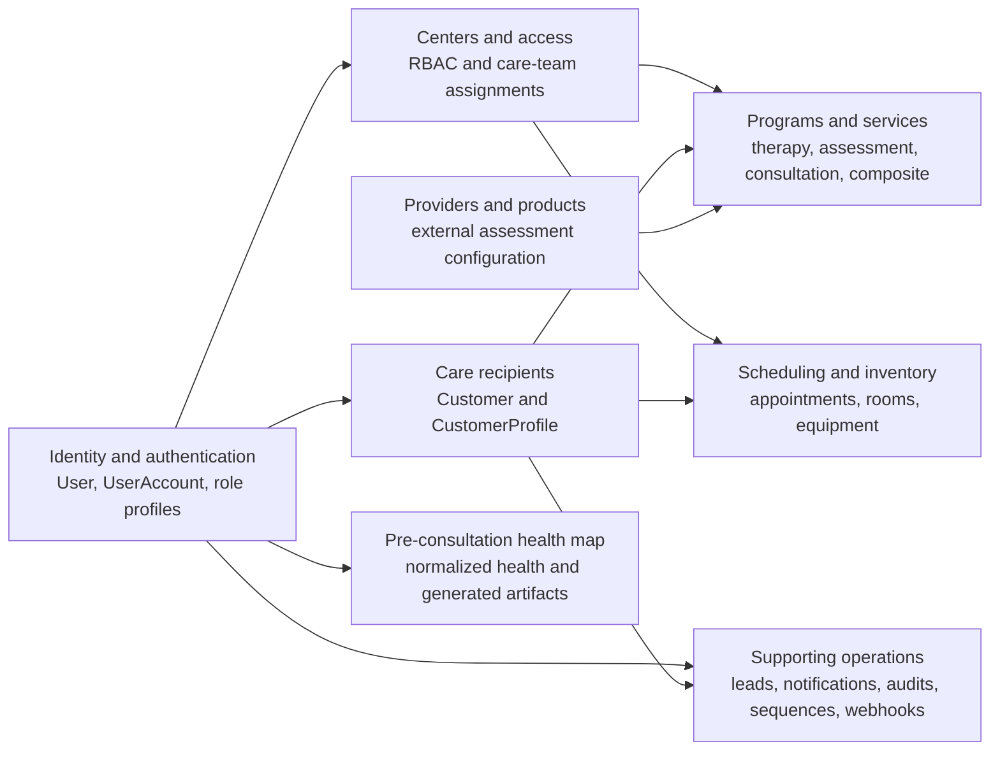

## Identity, accounts, and authentication

### The actual identity structure

`User` is the credential-bearing identity. `UserAccount` is a one-to-one
classifier that records the account type (`admin`, `associate`, `customer`, or
another supported value). The role-specific models do **not** point to
`UserAccount`; `Admin`, `Associate`, and `Customer` each point directly to the
same `User`.

This distinction matters:

- authentication answers **who is signing in**;
- `UserAccount` answers **which account experience applies**;
- the role extension answers **which role-specific data and behavior apply**;
- center and care-team assignments answer **where and in what context the person
  can act**.

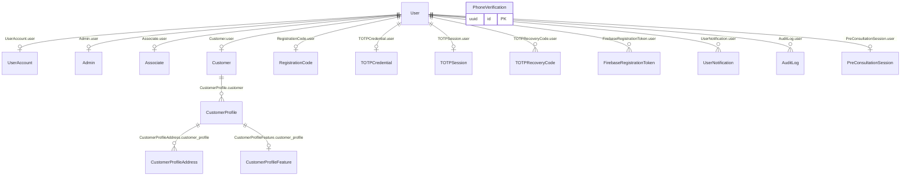

`PhoneVerification` is intentionally not connected to `User` by a foreign key.
It represents a short-lived verification challenge for a phone number and
purpose. A verified phone is resolved to a `User` by authentication logic.

### High-priority identity models

| Model | User-friendly purpose |
|---|---|
| `User` | The shared login identity. It holds password credentials, unique email and phone identifiers, active/staff state, and common identity fields. It should remain focused on information that authentication genuinely needs. |
| `UserAccount` | The account classifier used to determine whether an authenticated identity behaves as an admin, associate, or customer. It is a sibling extension of the role profile, not its parent table. |
| `Admin` | A platform-level operational profile. It keeps administrative contact data away from customer health and family-profile data. |
| `Associate` | The staff or practitioner profile. Professional information and contact details live here, while center-specific authority lives in `AssociateCenterAssignment`. |
| `Customer` | The customer account owned by a `User`. It can manage multiple care recipients through `CustomerProfile`. |
| `CustomerProfile` | The person receiving care. One customer login can represent the main member and dependants without creating separate login credentials for every family member. |

The authentication identifiers are deliberately separated by account workflow:

- admin and associate identities use `User.email`; their operational phone is
  stored as `Admin.contact_phone` or `Associate.contact_phone`;
- customer identities use `User.phone`; their contact email is stored as
  `Customer.contact_email`;
- JWT access and refresh tokens include the identity and resolved account type;
- password setup/reset uses registration or reset tokens;
- email/password login can require a second TOTP step;
- customer phone login uses a purpose-bound OTP challenge.

### Authentication flow

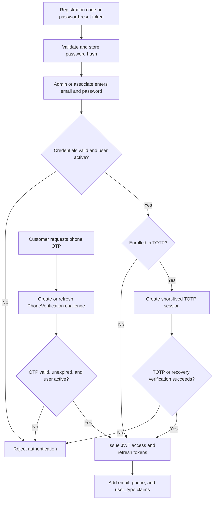

### Why separate user-type tables

A single `person` table containing authentication, professional, center-access,
family, health, emergency-contact, and provider-facing fields would accumulate
large groups of irrelevant nullable columns. It would also make authorization
queries and retention policies depend on repeated account-type conditionals.

The segmented design scales better because:

- each role can evolve without adding unrelated fields to every person;
- queries load smaller, purpose-specific records;
- foreign keys make invalid cross-type relationships harder to create;
- customer family profiles scale independently of login accounts;
- associates can hold different roles at different centers;
- access policies can target the tables that contain the relevant data;
- health, authentication, operational, and audit lifecycles can be governed
  separately;
- bridge tables can gain center-specific state without redesigning identity.

This separation is **compliance-supporting**, not proof of compliance by itself.
It can help implement role-appropriate access and data minimization. The HIPAA
Privacy Rule's minimum-necessary guidance calls for limiting unnecessary or
inappropriate access to protected health information, while GDPR principles
include purpose limitation and collecting only data necessary for that purpose.
Actual compliance also depends on policy, authorization, encryption, retention,
audit review, incident response, contracts, infrastructure, and operating
practice. See the official [HHS minimum necessary guidance](https://www.hhs.gov/hipaa/for-professionals/privacy/guidance/minimum-necessary-requirement/index.html)
and [European Commission GDPR principles](https://commission.europa.eu/law/law-topic/data-protection/information-business-and-organisations/principles-gdpr_en).

## Centers, RBAC, and care relationships

`Center` is the operational location boundary. It owns operating hours,
holidays, rooms, equipment, services, appointments, and assignment relationships.
It also carries denormalized counts used for operational views.

`AssociateCenterAssignment` is the center-specific access boundary. The same
associate can be an administrator or care staff member at one center and hold a
different role or mode at another center. `CustomerCenterAssignment` connects a
care recipient to centers and allows at most one primary center.
`CustomerAssociateAssignment` identifies the associate caring for a profile in
a particular center.

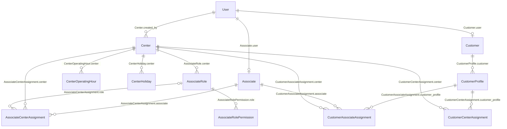

Important database rules include one associate-center row per pair, one
customer-profile-center row per pair, one primary center per customer profile,
and one customer-profile-associate-center care-team row per combination.

## Programs, services, providers, and composites

### Reusable definitions and client assignments

`Service` is a reusable catalogue definition. `CenterServiceAssignment` controls
where a service is offered, while `ServiceProductAssignment` connects assessment
services to provider products.

`Program` is a client-specific assignment attached to `CustomerProfile`. Its
issuing center is `center`, and its allowed redemption locations are represented
by the `redeemable_centers` many-to-many relation. `ProgramService` is the shared
line item connecting an assigned program to a reusable service.

The type-object pattern adds one-to-one extensions:

- `TherapyProgram` and `TherapyProgramService` carry session totals, usage,
  cancellation totals, and redeem codes;
- `AssessmentProgram` and `AssessmentProgramService` currently provide
  structural type identity without additional runtime fields;
- `ConsultationProgram` and `ConsultationProgramService` currently provide
  structural type identity without additional runtime fields;
- `CompositeProgram` identifies a program created from a `CompositeTemplate`
  and snapshots the template name and description;
- composite programs use the same `ProgramService` rows and type-specific
  service extensions rather than a separate composite-service table.

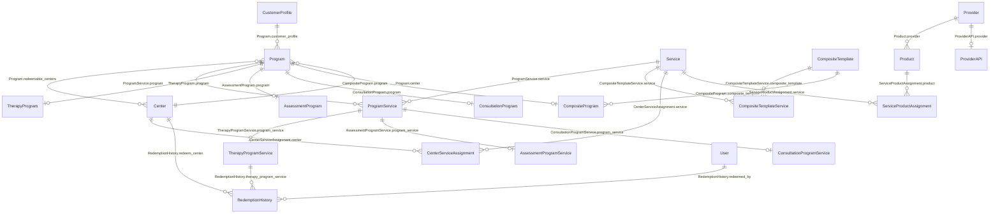

### High-priority program models

| Model | User-friendly purpose |
|---|---|
| `Program` | A plan assigned to one care recipient. It records the issuing center, allowed redemption centers, type, expiry, commercial state, and cancellation state. |
| `ProgramService` | One reusable service included in a specific program. It keeps catalogue definitions separate from client assignments. |
| `Service` | A reusable unit of delivery such as a therapy, consultation, or assessment. It can be global or made available through selected centers. |
| `Provider` | An external delivery or diagnostic organization, including supported callback behavior and provider-level data requirements. |
| `Product` | A provider's specific offering. Product callbacks and metadata let assessment behavior vary without changing the core service or program tables. |
| `CompositeTemplate` | A reusable mixed-service package definition. Counts by service category support fast administration and reporting. |

### Program creation and redemption logic

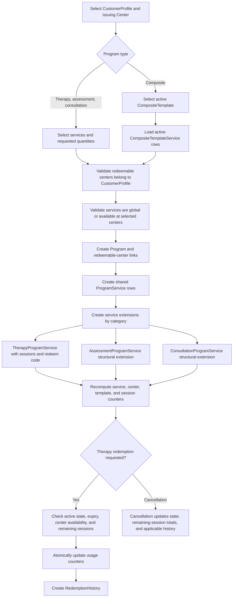

Program and service totals are denormalized for efficient listing and dashboards.
The corresponding utility functions recompute counts from relationship rows.
Redemption history is the event trail; usage and cancellation counters are the
current aggregate state.

## Appointments, rooms, equipment, and scheduling

An `Appointment` currently belongs to `Customer`, not `CustomerProfile`. Programs
and pre-consultation use different attachment points, so consumers of the schema
must not silently treat those relationships as interchangeable.

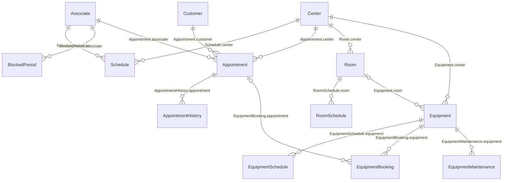

Availability is computed on demand rather than stored as slot rows:

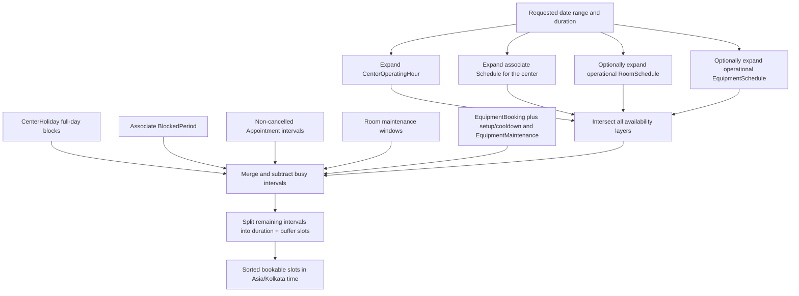

## Pre-consultation health model

`PreConsultationSession` is a one-to-one extension of `User`. It records
progression through a directive schema and is the root of a normalized health
map. Concerns, symptoms, family history, medical history, lifestyle answers,
scores, and goals are stored as separate rows instead of a single growing JSON
document. This supports targeted validation, selective retrieval, and clearer
retention and access policies.

### Intake and scoring relationships

```mermaid
erDiagram
    User ||--o| PreConsultationSession : "PreConsultationSession.user"
    PreConsultationSession ||--o{ PreConsultationCategorySelection : "PreConsultationCategorySelection.session"
    PreConsultationSession ||--o{ PreConsultationConcern : "PreConsultationConcern.session"
    PreConsultationConcern ||--o{ PreConsultationConcernSymptom : "PreConsultationConcernSymptom.concern"
    PreConsultationConcern ||--o{ PreConsultationConcernSource : "PreConsultationConcernSource.concern"
    PreConsultationConcern ||--o{ PreConsultationConcernFamilyHistory : "PreConsultationConcernFamilyHistory.concern"
    PreConsultationConcern ||--o{ PreConsultationConcernProbeAnswer : "PreConsultationConcernProbeAnswer.concern"

    PreConsultationSession ||--o| PreConsultationMedicalHistory : "PreConsultationMedicalHistory.session"
    PreConsultationMedicalHistory ||--o{ PreConsultationDiagnosis : "PreConsultationDiagnosis.medical_history"
    PreConsultationMedicalHistory ||--o{ PreConsultationAllergy : "PreConsultationAllergy.medical_history"
    PreConsultationMedicalHistory ||--o{ PreConsultationSurgery : "PreConsultationSurgery.medical_history"
    PreConsultationMedicalHistory ||--o{ PreConsultationMedication : "PreConsultationMedication.medical_history"
    PreConsultationMedicalHistory ||--o{ PreConsultationSexualHealthAnswer : "PreConsultationSexualHealthAnswer.medical_history"
    PreConsultationMedicalHistory ||--o{ PreConsultationMedicalReport : "PreConsultationMedicalReport.medical_history"

    PreConsultationSession ||--o{ PreConsultationLifestyleAnswer : "PreConsultationLifestyleAnswer.session"
    PreConsultationSession ||--o{ PreConsultationSessionClusterScore : "PreConsultationSessionClusterScore.session"
    PreConsultationSession ||--o{ PreConsultationHealthGoal : "PreConsultationHealthGoal.session"
```

### Post-completion artifacts

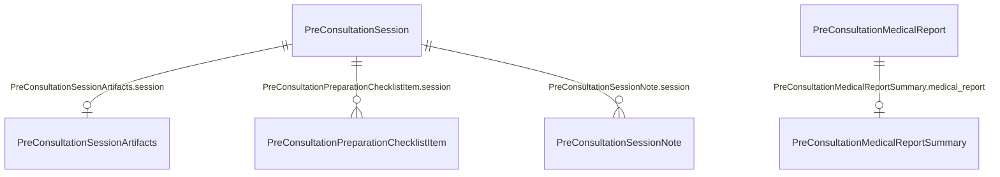

Layer handlers persist normalized answers, reset downstream layers when earlier
answers change, compute concern and cluster confidence, and store post-completion
summaries separately from the submitted source data.

## Supporting operational models

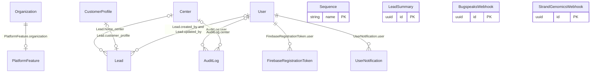

`Organization` is currently an independent platform root; there is no declared
foreign key from `Center` or a user-type model to it. `Lead` can be linked to a
home center and, after conversion, to one `CustomerProfile`. `AuditLog` uses a
typed entity identifier rather than a foreign key to every auditable model.
`Sequence` provides named counters for generated business codes. The webhook
models preserve provider payloads as JSON and currently have no declared
relationships to domain tables.

## Complete model inventory

### Identity, access, and centers

| App | Model | Role |
|---|---|---|
| `accounts.users` | `User` | Shared authentication identity and common identity fields. |
| `accounts` | `UserAccount` | One-to-one account-type classifier. |
| `accounts.admins` | `Admin` | Platform administration extension. |
| `accounts.associates` | `Associate` | Staff/practitioner extension. |
| `accounts.associates` | `AssociateRole` | Center-scoped or system role definition. |
| `accounts.associates` | `AssociateRolePermission` | Feature ability assigned to a role. |
| `accounts.associates` | `AssociateCenterAssignment` | Associate membership, role, mode, and flags per center. |
| `accounts.customers` | `Customer` | Customer login-account extension. |
| `accounts.customers` | `CustomerProfile` | Care recipient or dependant owned by a customer. |
| `accounts.customers` | `CustomerCenterAssignment` | Care-recipient membership and primary status per center. |
| `accounts.customers` | `CustomerAssociateAssignment` | Center-specific care-team link. |
| `accounts.customers` | `CustomerProfileAddress` | Address collection with one default per profile. |
| `accounts.customers` | `CustomerProfileFeature` | Profile-level feature switches and visible tabs. |
| `accounts.centers` | `Center` | Operational center and aggregate counts. |
| `accounts.centers` | `CenterOperatingHour` | Recurring center availability. |
| `accounts.centers` | `CenterHoliday` | Full-day center closure. |
| `accounts.organizations` | `Organization` | Platform organization record and aggregate counts. |
| `accounts.organizations` | `PlatformFeature` | Organization-wide feature configuration. |
| `accounts.verifications` | `PhoneVerification` | Purpose-bound phone OTP challenge. |
| `accounts.verifications` | `RegistrationCode` | One-time password-setup link state. |
| `accounts.verifications` | `TOTPCredential` | Enrolled TOTP secret and lockout state. |
| `accounts.verifications` | `TOTPSession` | Short-lived second-factor login session. |
| `accounts.verifications` | `TOTPRecoveryCode` | Hashed recovery code and use state. |
| `accounts.notifications` | `FirebaseRegistrationToken` | Push-notification device registration. |
| `accounts.notifications` | `UserNotification` | Delivered notification and seen state. |
| `accounts.audits` | `AuditLog` | Actor, action, center, entity reference, and metadata. |

### Programs, services, and providers

| App | Model | Role |
|---|---|---|
| `programs` | `Program` | Care-recipient program assignment. |
| `programs` | `ProgramService` | Shared assigned-service line. |
| `programs` | `TherapyProgram` | Therapy-level session aggregates. |
| `programs` | `TherapyProgramService` | Therapy service sessions, usage, cancellation, and redeem code. |
| `programs` | `AssessmentProgram` | Structural assessment program extension. |
| `programs` | `AssessmentProgramService` | Structural assessment service extension. |
| `programs` | `ConsultationProgram` | Structural consultation program extension. |
| `programs` | `ConsultationProgramService` | Structural consultation service extension. |
| `programs` | `CompositeProgram` | Client assignment created from a composite template. |
| `programs` | `RedemptionHistory` | Therapy redemption or cancellation event. |
| `programs.composites` | `CompositeTemplate` | Reusable mixed-service package definition. |
| `programs.composites` | `CompositeTemplateService` | Service and quantity within a template. |
| `programs.services` | `Service` | Reusable categorized service catalogue entry. |
| `programs.services` | `CenterServiceAssignment` | Explicit service availability per center. |
| `programs.services` | `ServiceProductAssignment` | Service-to-provider-product bridge. |
| `products` | `Provider` | External provider configuration and callback contract. |
| `products` | `ProviderAPI` | Provider API data extension. |
| `products` | `Product` | Provider-specific product and callback configuration. |

### Scheduling and physical resources

| App | Model | Role |
|---|---|---|
| `appointments` | `Schedule` | Associate recurring availability at a center. |
| `appointments` | `BlockedPeriod` | One-off associate unavailability. |
| `appointments` | `Appointment` | Booked customer/associate time at a center. |
| `appointments` | `AppointmentHistory` | Previous time window after rescheduling. |
| `inventory` | `Room` | Physical room within a center. |
| `inventory` | `RoomSchedule` | Room operational, maintenance, or reserved window. |
| `inventory` | `Equipment` | Physical device assigned to a center and optional room. |
| `inventory` | `EquipmentSchedule` | Equipment recurring availability or reservation. |
| `inventory` | `EquipmentBooking` | Equipment usage window and optional appointment. |
| `inventory` | `EquipmentMaintenance` | Scheduled and actual maintenance lifecycle. |

### Pre-consultation

| App | Model | Role |
|---|---|---|
| `pre_consultation` | `PreConsultationSession` | User-level intake session and progression root. |
| `pre_consultation` | `PreConsultationCategorySelection` | Selected health category. |
| `pre_consultation` | `PreConsultationConcern` | Concern, impact, probe, and confidence state. |
| `pre_consultation` | `PreConsultationConcernSymptom` | Symptom selected for a concern. |
| `pre_consultation` | `PreConsultationConcernSource` | Reported source of a concern. |
| `pre_consultation` | `PreConsultationConcernFamilyHistory` | Family relation and age-band risk. |
| `pre_consultation` | `PreConsultationConcernProbeAnswer` | Binary concern probe response. |
| `pre_consultation` | `PreConsultationMedicalHistory` | Session-level medical-history root. |
| `pre_consultation` | `PreConsultationDiagnosis` | Selected diagnosis. |
| `pre_consultation` | `PreConsultationAllergy` | Reported allergy. |
| `pre_consultation` | `PreConsultationSurgery` | Surgery, timing, and reason. |
| `pre_consultation` | `PreConsultationMedication` | Medication regimen. |
| `pre_consultation` | `PreConsultationSexualHealthAnswer` | Sexual-health question response. |
| `pre_consultation` | `PreConsultationMedicalReport` | Uploaded medical report metadata and file. |
| `pre_consultation` | `PreConsultationLifestyleAnswer` | Normalized lifestyle response. |
| `pre_consultation` | `PreConsultationSessionClusterScore` | Persisted cluster confidence calculation. |
| `pre_consultation` | `PreConsultationHealthGoal` | Ordered health goal. |
| `pre_consultation` | `PreConsultationSessionArtifacts` | Generated session summaries and status. |
| `pre_consultation` | `PreConsultationPreparationChecklistItem` | Generated preparation item and marked state. |
| `pre_consultation` | `PreConsultationMedicalReportSummary` | Generated report summary and flags. |
| `pre_consultation` | `PreConsultationSessionNote` | Associate-authored session note. |

### Other first-party models

| App | Model | Role |
|---|---|---|
| `leads` | `Lead` | Prospect and optional converted customer-profile link. |
| `leads` | `LeadSummary` | Singleton-style aggregate lead counters. |
| `sequences` | `Sequence` | Named persistent counter for business identifiers. |
| `webhooks.bugspeaks` | `BugspeaksWebhook` | Stored Bugspeaks webhook payload. |
| `webhooks.strand_genomics` | `StrandGenomicsWebhook` | Stored Strand Genomics webhook payload. |

The current `external`, `integrations`, `webhooks`, `webhooks.metsights`,
`programs.packages`, and `programs.vouchers` model modules do not declare
concrete database models.

## Exhaustive relationship catalogue

`Null` describes whether the source relation can be empty. One-to-one primary-key
extensions are marked `O2O (PK)`. Audit actor relationships are included because
they are real database connections even when they are not shown in every ERD.

### Identity, access, centers, and support

| Source field | Target | Type | Null | Delete behavior |
|---|---|---:|---:|---|
| `UserAccount.user` | `User` | O2O (PK) | No | `CASCADE` |
| `Admin.user` | `User` | O2O (PK) | No | `CASCADE` |
| `Admin.created_by` | `User` | FK | Yes | `SET_NULL` |
| `AssociateRole.center` | `Center` | FK | Yes | `CASCADE` |
| `AssociateRole.created_by` | `User` | FK | Yes | `SET_NULL` |
| `AssociateRolePermission.role` | `AssociateRole` | FK | No | `CASCADE` |
| `Associate.user` | `User` | O2O (PK) | No | `CASCADE` |
| `Associate.created_by` | `User` | FK | Yes | `SET_NULL` |
| `AssociateCenterAssignment.associate` | `Associate` | FK | No | `CASCADE` |
| `AssociateCenterAssignment.center` | `Center` | FK | No | `CASCADE` |
| `AssociateCenterAssignment.role` | `AssociateRole` | FK | Yes | `SET_NULL` |
| `AssociateCenterAssignment.created_by` | `User` | FK | Yes | `SET_NULL` |
| `Customer.user` | `User` | O2O (PK) | No | `CASCADE` |
| `Customer.created_by` | `User` | FK | Yes | `SET_NULL` |
| `CustomerProfile.customer` | `Customer` | FK | No | `PROTECT` |
| `CustomerProfile.created_by` | `User` | FK | Yes | `SET_NULL` |
| `CustomerCenterAssignment.customer_profile` | `CustomerProfile` | FK | No | `CASCADE` |
| `CustomerCenterAssignment.center` | `Center` | FK | No | `CASCADE` |
| `CustomerCenterAssignment.created_by` | `User` | FK | Yes | `SET_NULL` |
| `CustomerAssociateAssignment.customer_profile` | `CustomerProfile` | FK | No | `CASCADE` |
| `CustomerAssociateAssignment.associate` | `Associate` | FK | No | `CASCADE` |
| `CustomerAssociateAssignment.center` | `Center` | FK | No | `CASCADE` |
| `CustomerAssociateAssignment.created_by` | `User` | FK | Yes | `SET_NULL` |
| `CustomerProfileAddress.customer_profile` | `CustomerProfile` | FK | No | `CASCADE` |
| `CustomerProfileFeature.customer_profile` | `CustomerProfile` | O2O | No | `CASCADE` |
| `Center.created_by` | `User` | FK | Yes | `SET_NULL` |
| `CenterOperatingHour.center` | `Center` | FK | No | `CASCADE` |
| `CenterHoliday.center` | `Center` | FK | No | `CASCADE` |
| `PlatformFeature.organization` | `Organization` | O2O | No | `CASCADE` |
| `RegistrationCode.user` | `User` | O2O (PK) | No | `CASCADE` |
| `TOTPCredential.user` | `User` | O2O (PK) | No | `CASCADE` |
| `TOTPSession.user` | `User` | O2O (PK) | No | `CASCADE` |
| `TOTPRecoveryCode.user` | `User` | FK | No | `CASCADE` |
| `FirebaseRegistrationToken.user` | `User` | FK | No | `CASCADE` |
| `UserNotification.user` | `User` | FK | No | `CASCADE` |
| `AuditLog.user` | `User` | FK | Yes | `SET_NULL` |
| `AuditLog.center` | `Center` | FK | Yes | `SET_NULL` |
| `Lead.home_center` | `Center` | FK | Yes | `SET_NULL` |
| `Lead.customer_profile` | `CustomerProfile` | O2O | Yes | `SET_NULL` |
| `Lead.created_by` | `User` | FK | Yes | `SET_NULL` |
| `Lead.updated_by` | `User` | FK | Yes | `SET_NULL` |

### Programs, services, and providers

| Source field | Target | Type | Null | Delete behavior |
|---|---|---:|---:|---|
| `Program.customer_profile` | `CustomerProfile` | FK | No | `PROTECT` |
| `Program.center` | `Center` | FK | No | `PROTECT` |
| `Program.redeemable_centers` | `Center` | M2M | Yes | Implicit join rows |
| `Program.created_by` | `User` | FK | Yes | `SET_NULL` |
| `Program.cancelled_by` | `User` | FK | Yes | `SET_NULL` |
| `ProgramService.program` | `Program` | FK | No | `CASCADE` |
| `ProgramService.service` | `Service` | FK | No | `PROTECT` |
| `ProgramService.created_by` | `User` | FK | Yes | `SET_NULL` |
| `ProgramService.cancelled_by` | `User` | FK | Yes | `SET_NULL` |
| `TherapyProgram.program` | `Program` | O2O (PK) | No | `CASCADE` |
| `TherapyProgramService.program_service` | `ProgramService` | O2O (PK) | No | `CASCADE` |
| `AssessmentProgram.program` | `Program` | O2O (PK) | No | `CASCADE` |
| `AssessmentProgramService.program_service` | `ProgramService` | O2O (PK) | No | `CASCADE` |
| `ConsultationProgram.program` | `Program` | O2O (PK) | No | `CASCADE` |
| `ConsultationProgramService.program_service` | `ProgramService` | O2O (PK) | No | `CASCADE` |
| `CompositeProgram.program` | `Program` | O2O (PK) | No | `CASCADE` |
| `CompositeProgram.composite_template` | `CompositeTemplate` | FK | No | `PROTECT` |
| `RedemptionHistory.therapy_program_service` | `TherapyProgramService` | FK | No | `PROTECT` |
| `RedemptionHistory.redeem_center` | `Center` | FK | No | `PROTECT` |
| `RedemptionHistory.redeemed_by` | `User` | FK | Yes | `SET_NULL` |
| `CompositeTemplate.created_by` | `User` | FK | Yes | `SET_NULL` |
| `CompositeTemplateService.composite_template` | `CompositeTemplate` | FK | No | `CASCADE` |
| `CompositeTemplateService.service` | `Service` | FK | No | `PROTECT` |
| `CompositeTemplateService.created_by` | `User` | FK | Yes | `SET_NULL` |
| `Service.created_by` | `User` | FK | Yes | `SET_NULL` |
| `CenterServiceAssignment.service` | `Service` | FK | No | `CASCADE` |
| `CenterServiceAssignment.center` | `Center` | FK | No | `CASCADE` |
| `ServiceProductAssignment.service` | `Service` | FK | No | `PROTECT` |
| `ServiceProductAssignment.product` | `Product` | FK | No | `PROTECT` |
| `Provider.created_by` | `User` | FK | Yes | `SET_NULL` |
| `ProviderAPI.provider` | `Provider` | O2O (PK) | No | `CASCADE` |
| `ProviderAPI.created_by` | `User` | FK | Yes | `SET_NULL` |
| `Product.provider` | `Provider` | FK | No | `PROTECT` |
| `Product.created_by` | `User` | FK | Yes | `SET_NULL` |

### Appointments and inventory

| Source field | Target | Type | Null | Delete behavior |
|---|---|---:|---:|---|
| `Schedule.associate` | `Associate` | FK | No | `CASCADE` |
| `Schedule.center` | `Center` | FK | No | `RESTRICT` |
| `BlockedPeriod.associate` | `Associate` | FK | No | `CASCADE` |
| `Appointment.associate` | `Associate` | FK | No | `CASCADE` |
| `Appointment.customer` | `Customer` | FK | No | `CASCADE` |
| `Appointment.center` | `Center` | FK | No | `PROTECT` |
| `Appointment.created_by` | `User` | FK | Yes | `SET_NULL` |
| `Appointment.confirmed_by` | `User` | FK | Yes | `SET_NULL` |
| `Appointment.cancelled_by` | `User` | FK | Yes | `SET_NULL` |
| `AppointmentHistory.appointment` | `Appointment` | FK | No | `CASCADE` |
| `AppointmentHistory.rescheduled_by` | `User` | FK | Yes | `SET_NULL` |
| `Room.center` | `Center` | FK | No | `CASCADE` |
| `Room.created_by` | `User` | FK | Yes | `SET_NULL` |
| `RoomSchedule.room` | `Room` | FK | No | `CASCADE` |
| `RoomSchedule.created_by` | `User` | FK | Yes | `SET_NULL` |
| `Equipment.center` | `Center` | FK | No | `PROTECT` |
| `Equipment.room` | `Room` | FK | Yes | `PROTECT` |
| `Equipment.created_by` | `User` | FK | Yes | `SET_NULL` |
| `EquipmentSchedule.equipment` | `Equipment` | FK | No | `CASCADE` |
| `EquipmentSchedule.created_by` | `User` | FK | Yes | `SET_NULL` |
| `EquipmentBooking.equipment` | `Equipment` | FK | No | `PROTECT` |
| `EquipmentBooking.appointment` | `Appointment` | FK | Yes | `SET_NULL` |
| `EquipmentBooking.booked_by` | `User` | FK | Yes | `SET_NULL` |
| `EquipmentBooking.created_by` | `User` | FK | Yes | `SET_NULL` |
| `EquipmentMaintenance.equipment` | `Equipment` | FK | No | `CASCADE` |
| `EquipmentMaintenance.performed_by` | `User` | FK | Yes | `SET_NULL` |
| `EquipmentMaintenance.created_by` | `User` | FK | Yes | `SET_NULL` |

### Pre-consultation

| Source field | Target | Type | Null | Delete behavior |
|---|---|---:|---:|---|
| `PreConsultationSession.user` | `User` | O2O | No | `CASCADE` |
| `PreConsultationCategorySelection.session` | `PreConsultationSession` | FK | No | `CASCADE` |
| `PreConsultationConcern.session` | `PreConsultationSession` | FK | No | `CASCADE` |
| `PreConsultationConcernSymptom.concern` | `PreConsultationConcern` | FK | No | `CASCADE` |
| `PreConsultationConcernSource.concern` | `PreConsultationConcern` | FK | No | `CASCADE` |
| `PreConsultationConcernFamilyHistory.concern` | `PreConsultationConcern` | FK | No | `CASCADE` |
| `PreConsultationConcernProbeAnswer.concern` | `PreConsultationConcern` | FK | No | `CASCADE` |
| `PreConsultationMedicalHistory.session` | `PreConsultationSession` | O2O | No | `CASCADE` |
| `PreConsultationDiagnosis.medical_history` | `PreConsultationMedicalHistory` | FK | No | `CASCADE` |
| `PreConsultationAllergy.medical_history` | `PreConsultationMedicalHistory` | FK | No | `CASCADE` |
| `PreConsultationSurgery.medical_history` | `PreConsultationMedicalHistory` | FK | No | `CASCADE` |
| `PreConsultationMedication.medical_history` | `PreConsultationMedicalHistory` | FK | No | `CASCADE` |
| `PreConsultationSexualHealthAnswer.medical_history` | `PreConsultationMedicalHistory` | FK | No | `CASCADE` |
| `PreConsultationMedicalReport.medical_history` | `PreConsultationMedicalHistory` | FK | No | `CASCADE` |
| `PreConsultationLifestyleAnswer.session` | `PreConsultationSession` | FK | No | `CASCADE` |
| `PreConsultationSessionClusterScore.session` | `PreConsultationSession` | FK | No | `CASCADE` |
| `PreConsultationHealthGoal.session` | `PreConsultationSession` | FK | No | `CASCADE` |
| `PreConsultationSessionArtifacts.session` | `PreConsultationSession` | O2O | No | `CASCADE` |
| `PreConsultationPreparationChecklistItem.session` | `PreConsultationSession` | FK | No | `CASCADE` |
| `PreConsultationMedicalReportSummary.medical_report` | `PreConsultationMedicalReport` | O2O | No | `CASCADE` |
| `PreConsultationSessionNote.session` | `PreConsultationSession` | FK | No | `CASCADE` |

## Important constraints and implementation boundaries

- `User.email` and `User.phone` are independently unique when present.
- `CustomerProfile` uniqueness uses customer, case-insensitive name, gender, and
  date of birth, with null values treated as comparable.
- A customer profile can have only one default address and one primary center.
- Role permissions are unique per `(role, feature)`.
- `ProgramService` is unique per `(program, service)`.
- Composite-template services are unique per `(template, service)`.
- Service-center and service-product bridge rows are unique per pair.
- Pre-consultation selections and answers use session- or parent-scoped unique
  constraints to prevent duplicate semantic responses.
- Appointment and blocked-period end times must be after their start times.
- `Organization` is not currently connected to `Center` by a database relation.
- `PhoneVerification`, `LeadSummary`, `Sequence`, and webhook payload models are
  independent roots.
- Assessment and consultation program extensions are present in the schema but
  currently contain no subtype-specific runtime fields.

This document describes the relationships that exist today. It does not imply
foreign keys that are only conceptually convenient, and it does not treat the
schema alone as an authorization or compliance guarantee.
